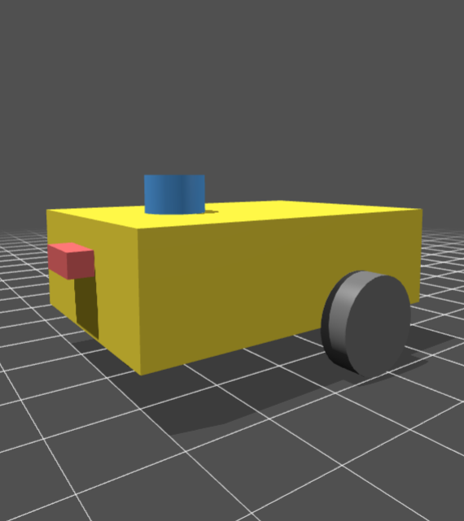

# Sentinel Substation Inspection Robot (ROS 2)



A ROS 2 autonomous mobile robot workspace for substation inspection in Gazebo Sim (`ros_gz_sim`), featuring 2D LiDAR SLAM mapping, Nav2 autonomous waypoint patrol, thermal hotspot anomaly detection, and battery state-of-charge monitoring with automatic return-to-dock fail-safe.

---

## Workspace Structure

- **`src/sentinel_description`** — Robot URDF/Xacro model (`sentinel_urdf.xacro`, `sentinel_gazebo.xacro`) with differential drive, 2D GPU LiDAR, RGB/thermal inspection camera, and RViz display launch (`display.launch.py`).
- **`src/sentinel_simulation`** — Gazebo Sim substation world (`substation_world.sdf`), ROS–Gazebo topic bridge (`bridge.yaml`), and simulation bringup (`sim.launch.py`).
- **`src/sentinel_inspector`** — SLAM mapping launch (`slam.launch.py`), saved substation map (`maps/substation_map.yaml`), full mission bringup (`mission_bringup.launch.py`), and inspection nodes:
  - `thermal_vision` (`thermal_vision_node.py`): Subscribes to `/camera/image_raw` and publishes `/thermal_anomaly` (`std_msgs/Bool`).
  - `battery_monitor` (`battery_monitor_node.py`): Tracks `/cmd_vel` and `/odom`, simulates 24V LiFePO4 battery drain/recharging on the dock, and publishes `/battery_soc` and `/battery_voltage`.
  - `patrol_manager` (`patrol_manager.py`): Uses `nav2_simple_commander` (`BasicNavigator`) to patrol substation bays, log thermal status to `~/substation_inspection_report.csv`, and return to dock `(0.0, 0.0)` when finished or if battery drops below `25%`.

---

## Prerequisites

- **ROS 2** (e.g., `/opt/ros/lyrical/setup.bash`)
- **Gazebo Sim & Bridge:** `ros_gz_sim`, `ros_gz_bridge`
- **Navigation & Mapping:** `nav2_bringup`, `nav2_simple_commander`, `nav2_map_server`, `slam_toolbox`
- **Robot & Vision Tools:** `robot_state_publisher`, `joint_state_publisher_gui`, `xacro`, `rviz2`, `cv_bridge`, `python3-opencv`

> **WSL2 / Wayland Note:** All RViz launch files in this workspace set `QT_QPA_PLATFORM=xcb` so RViz2's OGRE/GLX renderer runs cleanly under WSLg/Wayland. If you run `rviz2` manually from a terminal, use `QT_QPA_PLATFORM=xcb rviz2`.

---

## Build

```bash
source /opt/ros/lyrical/setup.bash
cd /home/ujjaw/power_Ws
colcon build --symlink-install
source install/setup.bash
```

---

## How to Run the Simulations

### 1. View the Robot Model in RViz (`sentinel_description`)
Inspect the URDF model and move wheel joints interactively:

```bash
ros2 launch sentinel_description display.launch.py
```

### 2. Launch Gazebo Substation Simulation (`sentinel_simulation`)
Starts Gazebo Sim with `substation_world.sdf`, spawns `sentinel` on the green charging pad at `(0.0, 0.0, 0.15)`, and starts `ros_gz_bridge`:

```bash
ros2 launch sentinel_simulation sim.launch.py
```

### 3. Map the Substation with SLAM (`sentinel_inspector`)
Run in separate sourced terminals:

```bash
# Terminal 1: Start Gazebo simulation
ros2 launch sentinel_simulation sim.launch.py

# Terminal 2: Start slam_toolbox + RViz2
ros2 launch sentinel_inspector slam.launch.py

# Terminal 3: Drive the robot manually to build the map
ros2 run teleop_twist_keyboard teleop_twist_keyboard
```

To save the generated map:
```bash
ros2 run nav2_map_server map_saver_cli \
  -f ~/power_Ws/src/sentinel_inspector/maps/substation_map \
  --ros-args -p use_sim_time:=true -p save_map_timeout:=10000.0
```

### 4. Run Autonomous Inspection Mission (`sentinel_inspector`)
Launches Gazebo Sim, Nav2 (`substation_map.yaml`), RViz2, `thermal_vision`, and `battery_monitor` together, then runs the autonomous patrol:

```bash
# Terminal 1: Bring up simulation, Nav2, RViz2, thermal vision, and battery monitor
ros2 launch sentinel_inspector mission_bringup.launch.py

# Terminal 2: Start autonomous patrol and generate ~/substation_inspection_report.csv
ros2 run sentinel_inspector patrol_manager
```

---

## Bridged ROS 2 Topics (`bridge.yaml`)

| Topic | Message Type | Direction |
| :--- | :--- | :--- |
| `/clock` | `rosgraph_msgs/msg/Clock` | Gazebo $\rightarrow$ ROS 2 |
| `/cmd_vel` | `geometry_msgs/msg/Twist` | ROS 2 $\rightarrow$ Gazebo |
| `/odom` | `nav_msgs/msg/Odometry` | Gazebo $\rightarrow$ ROS 2 |
| `/tf` | `tf2_msgs/msg/TFMessage` | Gazebo $\rightarrow$ ROS 2 |
| `/joint_states` | `sensor_msgs/msg/JointState` | Gazebo $\rightarrow$ ROS 2 |
| `/scan` | `sensor_msgs/msg/LaserScan` | Gazebo $\rightarrow$ ROS 2 |
| `/camera/image_raw` | `sensor_msgs/msg/Image` | Gazebo $\rightarrow$ ROS 2 |
